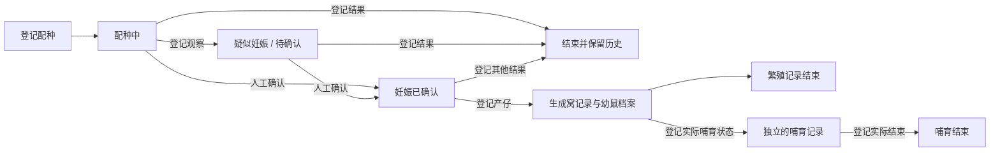
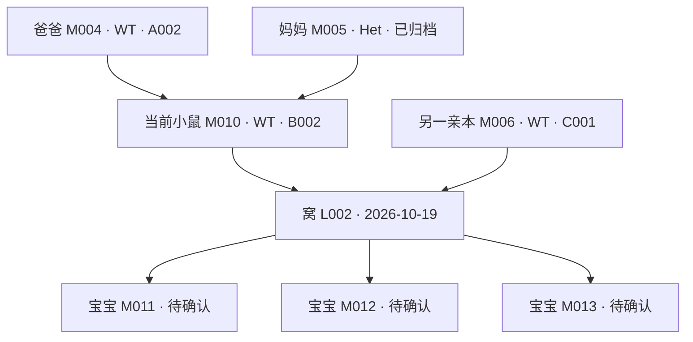

# 鼠鼠小窝｜小鼠饲养与繁殖管理系统

产品需求文档 · MVP v1.1 · 2026-10-22

本次补充：定期换笼计划、换笼日历、滴答清单接入与 iPhone 通知，并将换笼调度列为第一版核心能力。

> 打开首页，看见每一笼的鼠鼠，也立即知道今天该关注谁。

## 1. 产品定位与设计目标

面向生殖相关课题的实验室小鼠管理工具。以粉色、温柔、有生活感的动态鼠笼作为首页，同时提供准确的小鼠档案、笼位、周龄、繁殖记录和亲缘关系。

**产品主线：一个首页、两种管理视图、一个新增入口和一个换笼日历；从鼠笼进入个体，从个体追溯家庭，从日历与手机提醒完成定期管理。**

第一版同时满足四种需求：

| 需求 | 用户应当得到的体验 |
| --- | --- |
| 日常管理 | 搜索编号即可找到小鼠、所在笼位和周龄，快速登记、转笼、记录换笼 |
| 定期换笼 | 知道哪些笼今天该换、哪些已逾期；手机收到提醒，完成后自动安排下一次 |
| 繁殖研究 | 分清配种、疑似妊娠、已确认妊娠、哺乳等记录，能查看一只鼠的父母、同窝和后代 |
| 可爱有趣 | 笼内鼠鼠有睡觉、喝水、吃饭、探索等动作；家庭和生命阶段能通过小窝场景表达 |

设计遵循：

- **信息先于装饰。** 编号、周龄、容量和提醒始终清楚；动画位于独立场景区域。
- **布局承担解释。** 不堆叠宣传语、说明卡片和装饰性标签；必要解释放在首次引导或字段帮助里。
- **趣味动作与事实分开。** 动画是情境演绎；实验事实由用户登记，不能从动画、同笼关系或时间经过推断。
- **日常操作短路径。** 卡片进入详情；表单抽屉内完成操作，保存后保留搜索、筛选和滚动位置。
- **繁殖能力保持轻量。** 支持自然配种的基础记录和局部族谱，暂不建设完整实验管理平台。

默认使用环境：单实验室、受控访问环境，以桌面浏览器为主，兼顾平板与手机查看。第一版不含账号权限系统；真实数据必须持久化保存，不能仅保存在当前页面内存中。

## 2. 首页与信息架构

首页只设两个管理视图：**鼠笼 / 小鼠**。首次默认进入鼠笼视图，之后记住用户选择。顶部增加常驻的「换笼日历」入口，进入专用日历工作区并可一键返回原视图；日历不混入个体视图切换。

```text
鼠鼠小窝        搜索编号、基因型、笼号…    换笼日历    提醒 2    设置

[ 鼠笼 ] [ 小鼠 ]       全部笼位 ▾   繁殖状态 ▾      动画：开

┌ A001   3/5 ──────────┐  ┌ B002   4/5 ──────────┐
│       动态鼠笼        │  │      育幼小窝         │
│ 鼠鼠吃饭 / 喝水 / 睡觉 │  │ 母鼠与同笼的 3 只幼鼠 │
├─────────────────────┤  ├─────────────────────┤
│ M001 WT  ♂  9周3天   │  │ M010 WT ♀ 20周0天    │
│ M002 KO  ♀ 10周0天 ● │  │ L002 · 3只幼鼠       │
│ M003 Het ♀ 12周1天   │  │ M011 / M012 / M013   │
│ 下次换笼 10-25        │  │ 下次换笼 10-27        │
└─────────────────────┘  └─────────────────────┘

                                                     [ ＋ 新增 ]
```

以下为静态概念图，用于说明色彩、布局与场景层级；活动状态、数量和提醒为示例数据。实际动画行为见第 4 节。


[可编辑的 SVG 概念图](assets/cage-view-concept.svg)

### 2.1 页面层级

| 层级 | 内容 | 打开方式 |
| --- | --- | --- |
| 首页 | 双视图、搜索、筛选、提醒入口、统一新增 | 默认页面 |
| 换笼日历 | 月历、日程列表、当天任务、逾期项、批量完成 | 顶部「换笼日历」；返回保留原视图 |
| 笼位详情抽屉 | 放大的鼠笼、全部成员、容量、换笼计划及历史、转笼入口 | 点笼号或卡片空白区 |
| 小鼠详情抽屉 | 基础档案、繁殖、族谱、记录四个标签页 | 点鼠鼠形象或成员行 |
| 提醒抽屉 | 待处理、未来 7 天、已处理 | 点顶部提醒数量 |
| 表单抽屉 | 新增小鼠、新增笼位、登记一窝，以及编辑操作 | 统一新增或详情内动作 |
| 设置面板 | 默认容量、换笼周期模板、提醒时间与渠道、实验室时区、动效偏好 | 顶部设置 |

不新增独立的“繁殖首页”“族谱首页”或统计大屏。移动端抽屉改为全屏面板，保留返回路径。

### 2.2 唯一的全局新增入口

右下角「＋ 新增」展开三个动作：**新增小鼠 / 新增笼位 / 登记一窝**。

繁殖详情中的「登记产仔」复用“登记一窝”表单并预填母鼠与繁殖记录；不是另一套录入流程。顶部不再重复放新增按钮。

## 3. 粉色视觉系统

整体风格为轻盈的绘本式实验室：奶白背景、浅粉卡片、圆润的鼠鼠、简洁的木屑与小窝。避免大面积高饱和粉色、满屏爱心和影响阅读的装饰。

| 元素 | 建议色值 | 用法 |
| --- | --- | --- |
| 页面背景 | `#FFF8FB` | 大面积背景 |
| 卡片 | `#FFFFFF` | 信息区域 |
| 场景底色 | `#FCE7EF` | 鼠笼内部浅粉背景 |
| 主操作 | `#B83D70` | 新增、保存、选中态，搭配白色文字 |
| 主文字 | `#4A3040` | 编号、标题、关键数值 |
| 次级文字 | `#765F6B` | 日期与次要字段 |
| 边框 | `#EEDCE5` | 低干扰分隔；交互焦点使用更深轮廓 |
| 待处理 | `#A34A16` / `#FFF0DC` | 提醒文字 / 提醒底色 |
| 已完成 | `#356653` / `#E9F4EE` | 已处理文字 / 底色 |

配色为设计候选，交付界面时验证文字和控件的实际对比度。提醒同时使用图标、文字和颜色表达。

- 卡片圆角约 20px；输入框和按钮约 12px；页面使用 8px 间距体系。
- 正文建议 14–16px，鼠编号 16px 加粗，笼号 18px；信息区避免过小文字。
- 鼠笼卡片宽度建议 340–440px，场景高度约 180px。按可用宽度排 1–3 列，不为凑列数挤压文字。
- 鼠鼠使用统一的圆耳、短肢、长尾角色语言；尾部和动作帮助与仓鼠形象区分。
- 外观主题从白、浅灰、奶油色中稳定分配，同一只鼠刷新或转笼后保持一致。外观是装饰，不代表基因型、性别、品系或真实毛色。
- 性别使用 `♂ 雄 / ♀ 雌 / 待确认`；基因型显示文字，不能依靠粉蓝配色或毛色判断。
- 默认无音效；操作成功只显示轻量提示，不播放庆祝弹窗。

## 4. 动态鼠笼：可爱的主要载体

### 4.1 每张卡片是一个小窝

场景采用正面略带俯视的 2D / 轻 2.5D 剖面构图，避免粗重笼条遮挡小鼠。

| 区域 | 位置与内容 | 交互 |
| --- | --- | --- |
| 笼牌 | 卡片上沿：笼号、实际数量/容量、待处理数量 | 打开笼位详情 |
| 睡眠区 | 左侧：浅色窝垫、小纸巢 | 可出现睡觉、依偎、育幼姿态 |
| 活动区 | 中部：木屑与少量路径空间 | 走动、嗅闻、理毛、伸展 |
| 进食区 | 右下：食盆 | 吃饭动画 |
| 饮水区 | 右上：饮水瓶 | 喝水动画 |
| 成员区 | 场景下方固定列表 | 每行绑定唯一鼠 ID，可直接打开档案 |
| 日期区 | 卡片底部 | 优先显示下次换笼日期或逾期天数；最近换笼日期放详情及悬停补充；「记录换笼」直接打开表单 |

食盆、水瓶和垫料为场景道具，没有真实余量含义。第一版不显示虚构的饥饿值、饮水量、健康值或快乐值。

### 4.2 生活动画库

| 动作 | 视觉表现 | 动画节奏建议 | 范围 |
| --- | --- | --- | --- |
| 睡觉 | 蜷成小团、缓慢呼吸，偶尔出现小号 Z | 一次姿态持续 15–30 秒 | P0 |
| 喝水 | 面朝瓶口、轻微抬头和口部动作 | 每段 4–8 秒 | P0 |
| 吃饭 | 靠近食盆、前爪捧食、轻轻咀嚼 | 每段 5–10 秒 | P0 |
| 探索 | 短距离走动、停下嗅闻 | 行走 2–4 秒后停留 | P0 |
| 理毛 | 擦脸、挠耳、整理身体 | 每段 3–6 秒 | P0 |
| 发呆 / 伸展 | 静坐、眨眼、起身伸展 | 作为动作之间的过渡 | P0 |
| 育幼 / 依偎 | 母鼠在窝边休息、幼鼠团轻微起伏 | 以静态姿态和微动为主 | P0 |
| 整理窝材 | 叼纸片、轻推窝材 | 稀疏触发 | P1 |
| 同伴互动 | 靠近嗅闻、短暂停留后分开 | 稀疏触发，不遮挡选中鼠 | P1 |

这些时长是动效设计参数，不是对真实小鼠行为规律的描述。所有生活动画仅表示角色演绎。

### 4.3 动作调度规则

1. 每只已登记小鼠绑定一个稳定角色，不能为了丰富画面生成无档案的小鼠。
2. 空闲 → 选择目标区 → 移动 → 执行动作 → 空闲；动作不同步，避免整笼同时喝水或同时睡觉。
3. 使用固定路径点和位置槽；食盆、饮水瓶采用占位轮换，路径避开其他角色和信息区。
4. 场景内同一时刻最多两只鼠做明显位移，其余使用静止或小幅动作；不追逐、不连续弹跳。
5. 点击或键盘选中角色时暂停其位移并显示编号；同时高亮下方对应成员行，避免移动目标难以点击。
6. 登记为“未断奶”的幼鼠默认团簇休息、轻微挪动，人工登记“已断奶”后加入独立喝水、进食和探索动作库。断奶状态未记录的个体使用中性静坐、睡觉或理毛姿态，不因缺少断奶日期就被画成幼鼠。这个分界是产品表现规则，不用于判断实际发育情况。
7. 妊娠标签可搭配安静坐姿和轻微轮廓变化，但不根据孕日自动模拟腹围，不据此表达健康或胎仔数量。
8. 育幼场景只展示当前实际同笼成员；父鼠在其他笼时不能出现在本笼场景中，族谱中仍可见。
9. 卡片空间不足时以「幼鼠 × N」或「另有 N 只」展开入口表示折叠成员；文字总数必须覆盖全部个体。详情提供完整名单，不能漏计或凭空增加角色。

### 4.4 三类状态分别表达

| 状态类型 | 来源 | 展示位置 | 是否持久化 |
| --- | --- | --- | --- |
| 生活动作：睡觉、喝水、理毛 | 前端动画调度 | 场景内 | 否 |
| 业务事实：妊娠已确认、哺乳、未断奶 | 用户登记及其对应记录 | 成员行、详情状态区 | 是 |
| 关系身份：某鼠的妈妈、爸爸、子代 | 已登记亲缘关系 | 族谱、鼠详情 | 从关系数据计算 |

首次进入动态视图时用一次性轻提示说明「鼠鼠动作是趣味演绎，档案状态以登记为准」，随后保留设置中的说明入口。无需在每张卡片重复提示。

### 4.5 动效偏好与性能

- 首页提供全局动画开关，设置中可选“完整 / 轻动效 / 静态”；偏好持久保存。静态模式保留所有业务状态和操作。
- 跟随系统“减少动态效果”偏好，默认静态；减少移动效果不能禁用点击或管理功能。参考 [W3C 的减少动态效果技术说明](https://www.w3.org/WAI/WCAG22/Techniques/css/C39)。
- 持续自动播放的场景允许随时暂停；控件位于首页可见位置。参考 [W3C Pause, Stop, Hide](https://www.w3.org/WAI/WCAG22/Understanding/pause-stop-hide.html)。
- 仅对视口内卡片运行动画，页面退到后台时暂停；同时活跃的卡片目标上限为 6 张。
- 第一版建议使用可复用的矢量角色部件或精灵图，加轻量变换动画。不给每只鼠创建独立 3D 场景，不按动画帧请求后端。
- 渲染失败时降级为静态鼠头像和完整成员列表，核心操作仍能使用。

## 5. 小鼠与笼位的日常管理

### 5.1 小鼠档案

| 字段 | 规则 |
| --- | --- |
| 小鼠编号 | 必填且全局唯一；支持自动编号，内部使用不可变 ID 建立关系 |
| 昵称 | 选填，只作辅助显示；编号始终是主标识 |
| 品系 / 品系背景 | 选填，与基因型分开，支持搜索 |
| 基因型 | 可填写 WT、Het、KO 或实验室自定义文本；未知显示“待鉴定”，不从父母自动推断 |
| 出生日期 | 必填，不能晚于今天；可标记“估计日期” |
| 周龄 | 自动计算；默认显示“10周0天”，可切换一位小数；详情保留日龄 |
| 性别 | 雄 / 雌 / 待确认；幼鼠可以先不指定 |
| 当前笼位 | 在笼个体必填，笼位变更必须通过转笼流程 |
| 生存 / 去向状态 | 在笼、已转出、已死亡、已结束实验；后三者退出当前笼计数并保留历史 |
| 父鼠 / 母鼠 | 可空，支持确认或待确认；见族谱规则 |
| 出生窝号 | 登记一窝时自动关联，后续转笼不改变 |
| 断奶状态 / 日期 | 未记录、未断奶、已断奶；普通新增默认未记录，登记新生幼鼠默认未断奶。日期可空，已断奶但日期不详可如实登记；不能仅按年龄自动填写 |
| 最近笼具更换日期 | 展示当前笼的最近换笼日期；不是该鼠的转笼日期 |
| 最近转笼时间 | 来自该鼠转笼记录，独立展示 |

新增普通小鼠只展开编号、基因型、出生日期、性别、笼位五项；其他字段折叠在“更多信息”。保存成功后立即进入当前视图并高亮。

### 5.2 笼位管理

- 笼号唯一；记录容量、用途、最近换笼日期。用途为普通、配种、育幼、其他；用途是用户标记，不自动推断繁殖事实。
- 默认容量 5，可按笼调整，也可修改新建笼位的默认容量。容量数字是实验室配置，不是系统对所有饲养场景的适宜性判断。
- 卡片主计数为**全部在笼活体个数 / 配置容量**，包括未断奶幼鼠；详情可按已断奶、未断奶与状态未记录分别查看，缺少断奶日期不能作为幼鼠判定依据。
- 超容量时显示明确的数字提示，例如「7/5 · 超出2只」。新增、转笼和登记一窝在提交前展示结果；用户可以填写原因后继续如实登记，超量提示一直保留至数量或容量调整。
- 同笼异性在非配种用途下出现时给出提醒，不自动登记配种，也不自动认定父母关系。
- 空笼显示干净的小窝和「0/5」，允许编辑或删除；有在笼成员时不能删除，需先处理成员去向。
- 删除已有历史记录的笼位使用归档，历史事件仍显示当时笼号。

### 5.3 换笼与转笼必须分清

| 操作 | 含义 | 更新的数据 |
| --- | --- | --- |
| 记录换笼 | 清洁或更换当前笼的笼具、垫料，逻辑笼号不变 | 笼位最近换笼日期、换笼事件 |
| 转笼 | 指定小鼠由 A001 移到 B002 | 个体当前位置、双方笼计数、转笼事件 |

记录换笼默认今天，可补录历史日期；最近换笼日期取有效记录中的最近一次，不能被更早的补录覆盖。转笼不会自动修改目标笼的清洁日期。

转笼流程：选择一个或多个成员 → 选择目标笼 → 预览转移后双方数量及提示 → 提交。第一版通过表单完成，避免拖动动画角色误操作。操作整体成功或整体失败；失败不得出现个体同时属于两个笼或凭空消失。

对母鼠和未断奶子代提供“一并选择当前同笼幼鼠”，由用户确认实际移动名单，不自动带走整个族谱中的后代。

### 5.4 小鼠视图

默认列为：编号、基因型、性别、周龄、笼号、繁殖状态、提醒。编号列可附昵称，但不展示多行说明。

- 搜索支持编号、昵称、基因型、笼号；文本搜索与筛选按交集组合。
- 筛选支持基因型、性别、周龄区间、笼位、繁殖状态、未断奶、存在提醒，以及是否显示归档个体。
- 支持按周龄、编号、笼号排序；默认编号自然排序，同周龄时按编号稳定排序。
- 批量操作限于转笼、记录实际断奶和处理同类型提醒；不提供一键“全部确认怀孕”。
- 鼠笼视图筛选个体属性时展示包含匹配个体的笼，并高亮匹配成员；笼的计数始终为真实总数，避免误以为其他鼠已移走。

### 5.5 定期换笼计划（P0）

每个正在使用的笼位都应有明确的换笼计划，或标记为“未设置 / 已暂停”。未设置不能被当作正常计划并悄悄漏出提醒范围。

第一版采用**按实际换笼日期，每隔 N 个日历日安排下一次**的规则，支持全局模板、按笼覆盖和一次性调整。固定每周某几天的排班放入 P1，避免两种周期算法在第一版混用。

| 配置项 | 规则 |
| --- | --- |
| 周期 | 正整数天数；可批量应用模板，也可按笼覆盖；首次设置需由实验室确定 |
| 首次计划 | 有最近换笼记录时据此计算；未知时手动指定首次计划日期，不伪造换笼历史 |
| 提醒时刻 | 使用实验室时区，界面预填 09:00，可调整；这是产品提醒偏好，不是饲养要求 |
| 提前提醒 | 默认提前 1 天的同一时刻，可关闭；同一周期提前提醒和到期提醒分别去重 |
| 逾期跟进 | 默认每天 09:00 汇总一次未完成项，可关闭；不按每只鼠或每次刷新重复发送 |
| 单次改期 | 修改本次计划执行日，记录原因并保留原应换日；不改变长期周期或最近换笼记录 |
| 暂停 | 可指定恢复日和原因；暂停不等于已完成，历史和已产生的逾期记录保留 |

如配置周期为 7 天、最近实际换笼日为 2026-10-18，则原应换日为 10-25。若 10-24 提前完成，下一次为 10-31；若 10-27 才实际完成，下一次为 11-03。**7 天仅为计算示例，周期由实验室依据自己的饲养规则设置。**

关键规则：

1. 每个笼位同时最多有一个待执行换笼实例；实例有稳定 ID，改日期不换 ID。逾期多天仍是同一件事，不生成一串重复待办。
2. “原应换日”由当时基准和周期形成快照；“计划执行日”允许有理由地调整。延期后仍显示距原应换日的超期天数，不能通过移到明天抹去逾期事实。
3. 提前或延后实际完成后，下一周期一律从**实际换笼日**重新计算，不从点击保存的时间或原计划日计算。
4. “稍后提醒”只调整通知时间；“改期”调整本次计划；“完成换笼”必须登记实际日期。三者独立，读过通知不代表换过笼。
5. 换笼提醒的“完成”动作直接打开实际换笼表单，不能沿用普通周龄提醒的“已读式处理”；完成后原子保存 Event、实例状态、下一实例和待发送的同步操作。
6. 实际日期不能在未来。补录更早换笼事件不能覆盖更晚的有效事件；修正或撤销最新事件时重新计算当前计划，保留旧版本并同步更正外部任务。
7. 修改周期时预览受影响的笼与下一日期，明确选择本次生效还是下次完成后生效；已完成实例不改写。一个计划实例保存规则版本，防止历史随设置漂移。
8. 笼位变空或归档时暂停后续计划与外部通知；未完成实例标为暂停或取消并保留原因。重新启用时复核首次日期，不能自动把最近换笼日改成今天。
9. 配种、妊娠、哺乳笼可单独调整周期或暂停；系统不根据繁殖状态擅自延长或缩短周期。
10. 批量完成按笼勾选实际完成项，填写实际日期；每笼各存一条记录。未经勾选的笼保持原状态，不能因同一天有任务就被一并完成。

## 6. 繁殖管理：从配种到一窝幼鼠

### 6.1 生殖状态设计

“配种 / 妊娠”与“哺乳”分别记录，“妈妈 / 爸爸”由亲缘关系决定。它们可以同时存在，不能塞进一个互斥下拉框。

| 记录维度 | 状态 | 触发方式 | 页面呈现 |
| --- | --- | --- | --- |
| 繁殖过程 | 无当前记录 | 未登记活动中的繁殖记录 | 不额外贴标签；不等于确认未孕 |
| 繁殖过程 | 配种中 | 人工登记配种对象和开始日期 | 「配种中」 |
| 繁殖过程 | 疑似妊娠 / 待确认 | 记录见栓或其他观察依据 | 「待确认」及记录日期 |
| 繁殖过程 | 妊娠已确认 | 人工确认并填写日期和依据 | 「妊娠已确认」；有计时依据才显示孕日估计 |
| 繁殖过程 | 已结束 | 登记产仔、未孕、妊娠中止、取消或未知结果 | 留在繁殖历史中 |
| 哺育过程 | 哺乳中 / 已结束 | 登记产仔后明确选择；按实际哺育结束记录 | 「哺乳中」；可与妊娠标签并存 |
| 子代过程 | 未记录 / 未断奶 / 已断奶 | 出生登记 / 实际断奶登记或补录 | 未断奶显示「幼鼠」及日龄；未知不推断，断奶后显示常规个体 |
| 管理资格 | 停止繁殖 | 人工登记及可选原因 | 「停止繁殖」；保留全部亲缘关系 |

**见栓只能作为交配相关观察，不能自动等同于妊娠确认。** JAX 对这一点有明确说明，因此本产品将观察与确认分开保存。[JAX：How to time mouse pregnancy](https://www.jax.org/news-and-insights/2006/April/how-to-time-mouse-pregnancy)



允许从“配种中”“待确认”直接登记产仔，也允许没有此前配种记录而直接登记一窝；系统记录“前序信息未登记”，不能补造一次已确认妊娠。

### 6.2 配种与妊娠记录

从母鼠详情中的「繁殖」进入「登记配种」，选择候选父鼠、开始日期及当时笼位。配种登记本身不转笼；若不在同笼，提示先完成实际转笼记录。

一条繁殖记录围绕一只母鼠的一次繁殖过程。一个雄鼠与多只雌鼠配种时，分别建立记录。雄鼠详情可汇总自己参与的记录。

记录内容包括：

- 母鼠、候选父鼠、配种开始与结束日期；候选父鼠可未知或多名，此时不能自动确认子代父亲。
- 见栓日期等观察记录、确认妊娠日期、确认依据与备注。
- 可选的孕期计时基准日期、该日计时值、计时约定及依据。
- 可选预计产仔日期区间，以及该区间来自人工填写还是实验室已配置的规则。
- 过程结束日期与结果；产仔结果关联具体窝记录。

同一母鼠不能有两条相互冲突的活动妊娠记录；可以同时存在上一窝的哺育记录与新繁殖过程。

**孕日是基于登记规则的估计，确认日期不是受孕日期。** 系统不能用“确认妊娠日期 + 固定天数”伪造准确预产期；不知道基准就显示“孕日未登记”。第一版不强制统一 E0 / E0.5 约定，实验室选定约定后每条记录保留自己的基准快照。不同约定应显式保留，而非静默转换。[JAX 的计时约定示例](https://www.jax.org/news-and-insights/jax-blog/2014/September/six-steps-for-setting-up-timed-pregnant-mice)

### 6.3 登记一窝

表单必填：窝号、出生日期、当前活体幼鼠数、所在笼；母鼠优先预填，来源未知可留空。选填：父鼠及确认状态、出生总数、死亡或其他差额说明、出生日期是否估计、当前哺育状态。

提交前展示：将创建的幼鼠编号、所属窝、父母关系状态、保存后的笼总数。

保存结果必须一次性完成：

1. 建立一个窝记录，例如 `L20261019-01`。
2. 为每只当前活体幼鼠生成永久内部 ID 和临时展示编号，如 `L20261019-01-P01`；性别默认为待确认、基因型默认为待鉴定、断奶状态默认为未断奶。补录历史窝时可按实际情况调整当前断奶状态。
3. 写入每只幼鼠的实际笼位、出生日期、出生窝与已登记亲缘关系。
4. 关联既有繁殖过程；用户确认后结束该次过程，并独立保存哺育状态。
5. 计算容量与已配置的断奶提醒；显示结果。

临时编号以后可换成正式耳标编号，内部 ID 不变，族谱和提醒不重建。窝记录的历史出生数量与当前存活数量分开；当前数量由个体记录计算，不能把“1 窝”再作为一只鼠重复计数。

若补录整窝均未存活的记录，允许当前活体数为 0，并记录历史数量与结果；不得生成虚构的在笼个体。超出已登记个体的历史数量保持汇总，不编造个体身份。

### 6.4 断奶与后续流转

按一窝打开幼鼠清单，选择实际完成断奶的个体与日期，可在同一流程选择目标笼。允许分批断奶、不同目标笼，以及留在原笼。

记录断奶、转笼及双方计数在一次操作中保存。只有确认实际哺育结束才关闭母鼠的哺育状态；系统可提示“本窝已全部断奶”，但不凭年龄自动操作。

## 7. 族谱：关系清楚，入口轻巧

### 7.1 第一版展示范围

在小鼠详情中提供「族谱」标签，默认以当前小鼠为中心展示**父母、当前个体、直接子代**，同窝兄弟姐妹放在可展开行。点击任意节点可重新以该个体为中心查看。



节点显示编号、性别、基因型、当前笼号；选中节点强调。出生日期、周龄和更多状态进入详情后查看，避免树上信息过载。

- “鼠妈妈 / 鼠爸爸 / 鼠宝宝”是相对于所查看关系的身份。同一只鼠可以同时是上一代的子代和下一代的母鼠。
- “宝宝”在关系图中表示子代；是否未断奶另有状态，成年的子代不持续使用幼鼠外观。
- 实线表示已确认亲缘关系；虚线表示登记但尚未确认的候选关系，必须标注“待确认”。
- 父母未知时显示“父鼠未登记 / 母鼠未登记”，不能用同笼鼠自动填补。
- 同窝节点按出生窝聚合；同父母不同窝分开显示，避免把亲缘关系误认为同龄或同笼。
- 第一版直接子代超过 20 只时按窝折叠；不一次展开整群所有世代。

以个体、配种和窝建立关联，可以支持跨代追溯而不把关系绑在当前笼上。这与 JAX 对繁殖记录的基本组织方式一致。[JAX：Strategies for record-keeping](https://www.informatics.jax.org/silver/chapters/3-5.shtml)

### 7.2 关系约束

1. 个体不能成为自己的父母，也不能把自己的后代设为祖先；保存时检查循环关系。
2. 已知父母出生日期必须早于子代出生日期；估计日期造成冲突时要求复核后更正或解除候选关系。
3. 已确认的父鼠、母鼠分别要求已登记为雄、雌；性别未知时只允许候选关系，待补全后确认。
4. 候选配种对象不自动转为已确认父母。登记一窝时显式确认父母信息，可批量应用；父鼠不确定则保留未知或候选状态。
5. 同窝共享出生日期与已确认母鼠信息。修正这些共享字段时走窝记录的更正流程，预览关联幼鼠并整体更新；不同幼鼠的父鼠信息允许分别保持未知，不能强行补齐。
6. 修改关系必须记录旧值、新值、时间和更正原因；转笼、改编号、归档不改变关系。
7. 有亲缘、繁殖或历史事件引用的个体只能归档；无引用的误录空档案可以删除，操作前确认影响。
8. 已归档亲本仍显示在族谱中，并标明去向；不显示在当前笼里，也不继续产生当前管理提醒。

自然配种是本版关系模型的适用范围。寄养母鼠不能写进生物学母鼠字段；寄养独立字段与胚胎移植、多来源亲本等复杂关系放到后续版本。

## 8. 自动提醒：少打扰，有结果

### 8.1 提醒范围

| 类型 | 默认规则 | 展示与处理 |
| --- | --- | --- |
| 达到 10 周 | 出生日期 + 70 天 | 精确到日到期；用户标记“已处理” |
| 达到 20 周 | 出生日期 + 140 天 | 与 10 周提醒独立保留 |
| 即将达到目标周龄 | 未来 7 天内 | 放在“未来 7 天”，不计入待处理红点 |
| 妊娠待复核 | 仅在用户登记复核日期时启用 | 到期提示复核，不自动确认结果 |
| 预计产仔关注 | 仅存在有效人工区间或已配置规则时启用 | 标为“预计”；超过区间仍提示补充记录，不自动产仔 |
| 待断奶 | 登记计划日期，或启用实验室的日龄规则 | 到期生成提醒，不自动填断奶日期 |
| 换笼提前 / 到期 / 逾期 | 启用计划后按第 5.5 节生成 | 同一笼同一周期一条待办；支持手机提醒与日历，登记实际换笼后结束本周期 |

容量超限作为持续校验状态显示在笼卡和提交表单，不按每次刷新新增提醒事件。默认待处理徽标只统计已到期且未处理的提醒，数量指提醒条数，不是不同小鼠数。一个换笼实例在徽标中只计一次；提前、到期与逾期通知是同一实例的不同通知节点。

孕期、断奶和换笼的时间规则由实验室配置；初始不填入一个对所有品系和实验都适用的固定生物学期限。

### 8.2 周龄计算规则

以实验室时区的日历日期计算，默认 `Asia/Shanghai`：

```text
日龄 = 今天的日历日期 − 出生日期
完整周数 = 日龄整除 7
剩余天数 = 日龄除以 7 的余数
展示周龄 = 完整周数 + “周” + 剩余天数 + “天”
10 周到期日 = 出生日期 + 70 个日历日
20 周到期日 = 出生日期 + 140 个日历日
```

不能用四舍五入后的小数周龄触发提醒。例如 69 日龄可能显示为 9.9 周，但尚未达到 10 周；70 日龄才达到。估计出生日期显示 `约10周0天`，提醒同时标记“按估计出生日期计算”。

以 **2026-10-22** 为示例日期：

| 编号 | 出生日期 | 日龄 / 周龄 | 提醒结果 |
| --- | --- | --- | --- |
| M001 | 2026-08-17 | 66 天 / 9周3天 | 10-26 达到 10 周，出现在未来 7 天 |
| M002 | 2026-08-13 | 70 天 / 10周0天 | 当日产生 10 周提醒 |
| M010 | 2026-06-04 | 140 天 / 20周0天 | 当日产生 20 周提醒；10 周历史提醒仍按原状态保留 |
| M011 | 2026-10-19 | 3 天 / 0周3天 | 无 10 周或 20 周到期提醒 |

### 8.3 去重、补算与修正

- 提醒需要持久化状态：待处理、已处理、已取消。延期只改变再次展示时间，不创建新提醒。
- 周龄提醒唯一键为 `内部鼠ID + 目标周数`；其他提醒使用 `类型 + 关联记录ID + 本次周期ID`。出生日期或计划日期修改时更新同一条记录，而不是重复新建。
- 生成计算必须幂等；连续刷新、重复任务或两个窗口同时打开都只出现一条对应提醒。
- 服务端定时调度、打开应用及相关资料修改后重新计算。数天未打开应用仍须正常安排通知；服务中断恢复时补齐状态并保留原到期日，通知仅补发当前必要汇总，不把过去几天的通知逐条补响。
- 新增已经超过 20 周的个体时，10 周和 20 周均生成一次“录入前已到期”提醒，可批量确认；不能默默漏掉旧阈值。
- 点开详情不等于已处理，必须显式处理；处理后不因次日刷新再次通知，历史仍可查。
- 出生日期更正到未来阈值时，未处理提醒退回未来计划；已处理提醒保留原处理历史，标记“依据已更正”，只有用户明确选择“重新提醒”才重开。
- 提前结束妊娠过程、完成实际断奶或归档个体后，相关未处理提醒按原因取消或完成；已处理记录保留。
- 若计划日期变更，已处理状态同样保留并提示规则依据变化；不能无提示地恢复待处理。
- 第一版同时提供站内提醒、换笼日历和至少一种经过真机验证的 iPhone 通知渠道，首选滴答清单，备选 PWA 推送。具体渠道条件、发送状态与失败处理见第 8.5–8.6 节。

### 8.4 提醒文案

| 场景 | 文案示例 |
| --- | --- |
| 周龄到期 | `M002 · 今天满10周 · A001` |
| 即将到期 | `M001 · 4天后满10周 · A001` |
| 妊娠复核 | `M021 · 妊娠记录待复核 · B003` |
| 预计产仔 | `M021 · 进入预计产仔日期区间 · B003` |
| 断奶计划 | `L002 · 断奶计划今天到期 · 3只待处理` |
| 换笼到期 | `A002 · 今天换笼 · 上次10-15` |
| 换笼逾期汇总 | `有2笼换笼逾期 · 最早应换日10-20` |
| 容量超限 | `B002 · 7/5 · 超出2只` |

使用清楚、平静的语言，不将真实管理事项写成“鼠妈妈等你来帮忙”等情绪化催促。

### 8.5 手机通知与滴答清单接入

**交付顺序：先做完整的本地业务记录与后台调度，再打通滴答清单 → iPhone 提醒；若该账号或接入方式不能满足提醒能力，则使用 PWA Web Push 完成手机通知验收。** 第一版至少交付一种手机渠道，不要求用户同时配置两种。换笼、10/20 周龄、妊娠复核和断奶计划共用通知框架，首轮重点验证换笼。

截至 2026-10-22，滴答清单官方文档已提供远程 MCP 地址 `https://mcp.dida365.com`，使用 Streamable HTTP，支持 OAuth 或 Bearer Token，以及任务查询、创建、修改和完成。优先接官方服务，无需先依赖第三方逆向接口。[滴答清单官方 MCP 文档](https://help.dida365.com/articles/7438132116019216384)

| 渠道 | 用户体验 | 接入要求与边界 |
| --- | --- | --- |
| 滴答清单（首选） | 计划进入指定清单，手机滴答按设置提醒，点任务链接回到具体笼位或换笼实例 | 授权对应账号、选择专用清单、设置任务提醒，并在 iPhone 允许滴答通知；国内滴答与国际 TickTick 的端点和账号需分别验证 |
| PWA Web Push（备选） | 将鼠鼠小窝添加到 iPhone 主屏幕，授权通知后接收系统通知 | HTTPS、主屏幕 Web App、支持的 iOS 版本、订阅与后台发送服务；需要实际设备验收 |
| 站内提醒与日历（始终提供） | 查看待办、逾期和历史；渠道不可用时仍可管理 | 是业务事实的入口；用户关闭页面后仅靠它们不会发出手机通知 |

滴答的任务日期和通知提醒必须分别配置，不能将“任务已创建”视为“手机一定会响”。滴答支持应用外与锁屏提醒，并要求用户启用通知权限。[滴答清单提醒说明](https://help.dida365.com/articles/6950660229746917376)

**滴答适配的开发要求：**

- 系统后台作为 MCP 客户端按确定性规则调用工具，保存账号、目标清单和外部任务 ID；定期执行不能依赖聊天模型主动想起、桌面客户端常开或某次对话存活。
- 在开发接入时读取实际工具 schema，验证创建、改期、读取、完成，以及明确写入提醒时间的能力。官方帮助页列出了任务操作，但不因此假定所有提醒字段、Webhook 或高级重复规则都可用。
- 若该 MCP 不能直接写提醒，验证其是否能可靠使用用户设置的清单/任务默认提醒；仍不满足就走受支持的服务接口或 PWA 渠道，不能用“有到期日”冒充已配置通知。国际版 Open API 文档明确区分 `dueDate` 与 `reminders`，该事实不能直接证明国内滴答 MCP 的字段兼容性。[TickTick 开发者文档](https://developer.ticktick.com/)
- 用一个换笼实例对应一个普通任务，例如 `换笼 · A001 · 10月25日`，内容为笼号、计划时间和返回链接。周期由本系统统一生成；不同时开启滴答自身重复规则，以免双重创建。
- 实际完成在本系统登记后，更新对应外部任务并安排下一次；改期更新原任务，不能删除重建来逃避去重。只同步本系统拥有映射的任务，不改动用户其他清单内容。
- 第一版不把在滴答上勾选任务自动等同于实验室实际换笼。任务中引导回到系统记录实际日期；若能读取到外部完成状态，显示“外部已勾选，待登记”，经用户确认后才顺延下一周期。
- 外部删任务、改日期或取消授权不回写最近换笼记录；标为待核对 / 同步中断，由用户重试或重新授权。不承诺即时双向同步，Webhook 未核实时不能作为既有能力。
- 授权信息保存在服务端受保护存储，不放进前端、仓库或任务正文；第一版使用一个指定的通知接收账号。实验数据链接仍经现有访问控制，链接本身不携带访问密钥。

**iPhone PWA 的已核实前提：** Apple 的 WebKit 文档说明，iOS / iPadOS 16.4 起，添加到主屏幕的 Web App 可请求 Web Push 权限；授权需用户主动交互，通知受系统权限与专注设置影响。本项目用“添加到主屏幕 → 开启通知 → 发送测试通知”的流程引导，不将普通浏览器标签页打开一次视为配置完成。[WebKit：Web Push for Web Apps on iOS and iPadOS](https://webkit.org/blog/13878/)

本次更新完成的是产品设计和官方能力核实，尚未连接用户的滴答账号，也未创建外部任务或完成手机通知实测。插件目录可检索到未安装的 TickTick 插件，但国内滴答账号的适配需单独确认；本文不把“发现插件”视为“已接入”。

### 8.6 发送可靠性与通知偏好

1. 服务端至少每分钟检查到期通知，业务提交后及时入队；后台任务与静态页面独立运行。部署必须提供持久化数据库、调度器和可重试队列，只有静态托管不能满足本需求。
2. 提醒业务状态与渠道发送状态分开。任务同步成功、通知服务已接受、用户已读、实际换笼已完成是四种不同结果；没有设备回执就不展示“已送达手机”。
3. 同一实例的通知唯一键为 `实例ID + 渠道 + 通知节点 + 通知日期`，并校验当前计划版本；过期版本不再发送。重试前核对外部任务映射，防止请求超时但外部创建成功后再次建任务。
4. 外部创建结果不确定时先用可查询的关联标识核对，不能无条件重试新建；无法确认时保留“待核对”，避免制造重复任务。每个有效外部任务映射持久保存。
5. 临时失败按退避间隔重试并遵守服务限流；鉴权失败暂停该渠道并显示重新连接入口；PWA 订阅失效时停用该订阅。一个渠道出错不回滚已经登记的实际换笼。
6. 用户选择一个主手机渠道，默认不向多个渠道同时发送同一提醒。备用渠道只在已授权且用户启用回退后使用；服务商已接受通知但手机未显示时，不凭猜测向其他渠道再发一次。
7. 多笼同一时间到期，PWA 合并为一条汇总；滴答仍按笼创建任务，具体系统通知分组由滴答决定，不能承诺控制其合并方式。逾期汇总默认每日一次，不为每个笼额外创建新“逾期任务”。接入时必须验证更新既有任务提醒是否满足逾期重提醒；无法满足的渠道不得展示已启用该能力，需采用满足要求的 PWA 方案完成验收。
8. 可配置静默时段，默认 22:00–08:00；落在静默时段的提醒移到结束后，实际计划日期不改。对滴答需在写入时调整具体提醒时间，并说明用户的系统通知设置仍独立生效。
9. 断网或停机恢复时进行幂等对账，只补发一次当前待办汇总；已完成、已取消或已暂停实例不再补发历史通知。更换时区需预览待发送时间变化，历史实际日期不变。
10. 设置显示渠道是否连接、最近成功同步时间、失败状态及“测试通知”。外部任务默认只包含笼号和换笼时间，基因型、繁殖备注与完整档案不自动外发。

## 9. 换笼日历（P0）

### 9.1 页面与视觉

从首页「换笼日历」进入；桌面默认月视图，手机默认按日期分组的日程列表。顶部只保留返回、年月导航、今天、月历/日程切换及笼位筛选，延续浅粉色和留白。

```text
‹ 鼠笼       换笼日历       ‹ 2026年10月 ›   今天     月历 | 日程

逾期 2笼                                      全部笼位 ▾

                 月历网格                     10月22日 周四
        每格显示笼号 + 状态，最多3条             □ A002  今日换笼
        更多项目以“+N”展开                     □ B003  今日换笼
        今天浅粉描边                           已选0笼   记录完成

待执行：浅粉  ·  逾期：琥珀  ·  已完成：鼠尾草绿  ·  预测：虚线
```


[可编辑的日历 SVG 概念图](assets/cage-calendar-concept.svg)

| 内容 | 呈现与操作 |
| --- | --- |
| 当前计划 | 按计划执行日显示「A001 · 待换笼」；点击打开实例详情及记录完成入口 |
| 今日到期 | 今日日期明确高亮；侧栏列出当日笼位、最近换笼日和操作按钮 |
| 逾期任务 | 保留原应换日，在当前日期旁的逾期面板可直接处理；不因翻到本月而漏掉上月逾期 |
| 延期任务 | 放在新的计划执行日，显示「改期」与原应换日；没有实际换笼前不显示绿色完成 |
| 已完成 | 显示在实际完成日；详情保留原计划日、实际日和提前/逾期天数 |
| 远期预测 | 虚线展示，标记“预测”；依赖上一轮按期完成，不创建外部通知 |
| 未设计划 / 已暂停 | 过滤器中单独可见；没有日期的条目不随意塞进今天 |

### 9.2 日历操作与实例生成

- 支持按笼号、笼用途、状态筛选；日期格最多显示 3 条，其余点击 `+N` 查看完整清单。
- 选中日期后右侧显示当天任务；手机点击日期进入当天清单。每项直接进入笼位或实际换笼表单，无需回首页重新搜索。
- 默认“记录完成”填写今天，允许修改为实际历史日期；批量完成展示笼号清单和各自下一日期预览。
- 改期使用日期表单并记录原因，P0 不加入拖拽改期，避免拖动时无意改变管理计划。
- 日历按需要展示未来 60 天预测，但**只有每笼当前的一个实例是确定待办**。预测日期按当前计划日和周期推算，实际提前或延后完成后统一重算，不能把预测包装成已确认排班。
- 完成、改期、暂停、换周期后，日历、笼卡、提醒列表共享同一实例数据立即更新；外部同步允许短暂延迟并显示状态。
- 已完成事件与待办分开展示；同一实例不能被作为“原计划已完成”和“实际完成”重复计数。原日期只在详情和历史中追溯。
- 从日历返回首页保留原来搜索、筛选与滚动位置。空白日期显示轻量空态，不插入占空间的动画装饰。

系统内日历是第一版能力。订阅到 Apple 日历的 ICS Feed、周视图与固定星期排班列为 P1；日历订阅不作为手机准时通知的唯一保证。

## 10. 核心用户流程

### 场景 A：早上检查全部鼠笼

打开首页 → 看顶部待处理数量 → 查看有提醒的笼卡 → 点击 M002 → 确认编号、周龄和笼位 → 完成实际工作后标记提醒已处理。鼠笼内其他角色继续轻动效，不弹出全屏打断。

### 场景 B：登记母鼠妊娠

搜索母鼠 → 打开繁殖标签 → 新建或选择本次繁殖记录 → 登记观察或确认结果及日期 → 可选填写计时基准与预计区间 → 保存。卡片状态来自保存结果，动画随状态更新；不会仅凭“配种已过若干天”自动怀孕。

### 场景 C：一窝幼鼠出生

母鼠详情点「登记产仔」 → 填日期、当前活体数、确认父母信息、所在笼 → 检查自动编号和新容量 → 保存 → 小窝出现对应数量的幼鼠表现，母鼠族谱出现这一窝。重复点击保存也只生成一次。

### 场景 D：幼鼠断奶并分笼

从提醒或窝记录进入幼鼠列表 → 勾选实际断奶个体 → 填实际日期、补充性别与正式编号 → 分配目标笼 → 查看容量提示 → 保存。族谱关系、窝号与内部 ID 保持不变。

### 场景 E：跨笼追溯一家鼠

打开子代 → 族谱 → 点母鼠节点 → 查看母鼠所在笼及历次窝记录 → 点另一窝查看兄弟姐妹。即使父鼠已归档、子代分散在多个笼，也能保留关系。

### 场景 F：设置周期并在手机上收到换笼提醒

设置实验室周期模板 → 选择适用笼位并核对首次日期 → 在通知设置授权滴答并选择专用清单 → 按向导完成提醒配置与手机测试 → 后台为各笼同步当前换笼任务 → iPhone 提醒到期 → 点链接回到实例，登记实际完成日期 → 自动生成下一轮。

### 场景 G：某天集中换笼，但有一笼延期

打开日历当天清单 → 勾选实际完成的笼并保存 → 为剩余一笼填写新计划日和原因 → 已完成项出现在实际日期，下一轮分别顺延 → 延期笼仍可见原应换日与超期时间，外部任务更新日期而非新增。

## 11. 数据结构与一致性

原来的两张表可以支撑登记与笼位，但无法可靠保存多次繁殖、同窝关系、提醒已处理状态和转笼历史。沿用六类基础业务数据，增加换笼计划、换笼实例及通知接入记录；这些后台对象不增加首页管理视图。

以下为逻辑结构，字段名称用于表达含义，不锁定技术栈。

| 对象 | 核心字段 | 责任 |
| --- | --- | --- |
| Mouse | id、code、nickname、strain、genotype、birth_date、birth_date_precision、sex、current_cage_id、life_status、mother_id/father_id 及确认状态、candidate_parent_ids、litter_id、weaning_status、weaned_on、breeding_eligible、avatar_seed | 个体档案、当前位置、亲缘与形象身份 |
| Cage | id、code、capacity、purpose、archived_at；last_cleaned_on 从有效事件求得或缓存 | 笼位属性；当前数量从 Mouse 计算 |
| BreedingRecord | id、dam_id、candidate_sire_ids、cage_id_at_start、started_on、ended_on、status、confirmed_on、confirmation_basis、dating_reference、expected_birth_range、review_on、outcome | 一次繁殖过程，保留计时依据与结果 |
| Litter | id、code、breeding_record_id、birth_date、birth_date_precision、dam_id 及确认状态、birth_total、initial_live_count、historical_loss_count、nursing_status、nursing_ended_on、planned_weaning_on | 出生窝、历史数量和哺育状态；个体父亲以 Mouse 关系为准 |
| Event | id、type、关联对象、effective_at、recorded_at、before/after、reason、supersedes_event_id、operation_id | 换笼、转笼、观察、断奶、关系更正、去向等历史；更正不抹去旧值 |
| Reminder | id、type、subject_id、threshold_or_cycle、due_on、status、processed_at、snoozed_until、basis_snapshot、unique_key | 去重与提醒生命周期 |
| CageCarePlan | id、cage_id、interval_days、effective_from、initial_due_on、rule_version、pending_rule、status、pause_until、pause_reason | 周期、首次计划、规则快照与暂停；当前每笼一个有效计划 |
| CageCareOccurrence | id、plan_id、cage_id、rule_version、original_due_on、planned_on、status、completed_on、completed_event_id、reschedule_reason、revision | 稳定的单次任务；每笼最多一个待执行实例；预测不作为实际任务存储 |
| NotificationConnection | id、provider、account_ref、project_ref、credential_ref、push_subscription_ref、status、last_success_at | 指定接收账号、渠道和授权引用；凭据放受保护存储 |
| ExternalTaskLink | occurrence_id、connection_id、external_project_id、external_task_id、external_state、sync_revision、sync_state | 本系统实例与外部任务的稳定映射和同步状态 |
| NotificationDelivery | id、reminder_id、occurrence_id、connection_id、node、scheduled_at、source_revision、dedupe_key、status、attempts、next_retry_at、accepted_at、error | 持久化待发送操作、重试与服务接收结果；外部同步操作可使用同一事务发件箱机制 |
| Settings | timezone、default_capacity、age_thresholds、upcoming_days、可选繁殖/断奶规则、换笼周期模板、提醒时间与提前量、静默时段、主通知渠道、motion_preference | 实验室规则与个人展示偏好可分开存储 |

必要约束：

- 统一使用不可变内部 ID 做关联，展示编号可更正但必须唯一，并保留历史编号供追溯。
- 在笼 Mouse 只能有一个有效 `current_cage_id`；退出当前饲养后置空，历史位置在 Event 中查询。
- 周龄、笼内数量、父母角色、当前子代数量属于派生结果，不分别手工维护。
- Mouse 上的亲缘关系是个体事实来源；Litter 的共享母鼠字段与成员更正需保持一致，候选父亲不等同于已确认父亲。
- 清洁日期和位置历史由不同事件记录；日期字段使用日历日期，操作时间保存时间戳并按实验室时区显示。
- 跨对象操作使用事务或等效的原子提交；服务端重复提交使用操作 ID 去重。
- 两个窗口编辑同一资料时检查版本冲突，提示重新加载并保留用户输入，不能静默覆盖。
- 关系更正、出生日期修正与业务事件都保留历史；暂停动画不写业务事件。
- 数据保存在持久化数据库。发布时提供运维备份与恢复方式；第一版不另建复杂的备份管理页面。
- 记录换笼时将业务变更与待同步操作写入同一数据库事务，外部调用在提交后执行；不能因为滴答不可用而丢失实际换笼记录。
- `CageCareOccurrence` 是换笼计划事实来源，`Reminder` 只引用它；日历、笼卡和外部任务不各自计算一份可编辑日期。
- 预测与已生成实例区分；下一周期创建使用前次完成实例作幂等关联，重复提交或重跑调度不能多生成一轮。
- 外部任务只维护已映射的自有对象；取消授权后停止后续同步，不能声称已撤回设备上已经显示的通知。

## 12. 空态、异常与可用性

| 情况 | 界面处理 |
| --- | --- |
| 首次进入无数据 | 一个空的小窝和「添加第一个笼位」，打开统一新增中的笼位表单 |
| 搜索无结果 | 显示当前关键词与清除筛选；不把有数据的笼误显示为空笼 |
| 基因型或性别未知 | 显示待鉴定 / 待确认，允许后补，不虚构值 |
| 繁殖资料缺失 | 显示未登记；允许直接补录产仔，不强迫伪造完整流程 |
| 保存失败 | 保留表单输入、说明失败并允许重试；不先永久改变场景成员 |
| 数据载入失败 | 显示重试入口；已读缓存如有展示需标记更新时间，不伪装为最新数据 |
| 超容量 | 用数字、图标和文字持续展示，允许记录实际情况并说明原因 |
| 鼠已归档 | 停止在当前笼出现，仍可从历史和族谱打开 |
| 卡片成员较多 | 折叠视觉成员并显示剩余数量；完整清单可访问 |
| 关闭动画 | 场景为静态，身份和状态仍清楚，所有操作仍可用 |
| 未设换笼周期 | 笼卡与日历筛选中显示“未设计划”，提供批量设置入口 |
| 滴答授权或任务同步失败 | 保留本地计划，显示重新连接 / 重试；不显示虚假的已通知状态 |
| iPhone 未授权通知 | 引导开启权限并提供测试；用户拒绝后保留站内功能，不循环弹窗 |
| 外部任务已勾选但没有实际记录 | 提示“待登记实际换笼”，不自动顺延下一次 |

支持键盘选择成员、打开详情和提交表单，焦点轮廓可见。不能只用悬停呈现必要信息；手机点击成员行即可完成同样操作。按钮与触摸目标建议不小于 44×44px。

删除、归档、批量转笼和关系更正提交前显示作用对象与影响；不要求每次普通字段保存都弹确认。所有校验错误定位到具体字段。

## 13. 第一版范围与后续边界

### P0：第一版必须交付

| 模块 | 交付内容 |
| --- | --- |
| 基础管理 | 小鼠与笼位 CRUD、搜索筛选、去向归档、容量提示 |
| 双视图 | 粉色鼠笼卡片与小鼠列表；一致的真实数据 |
| 动态场景 | 睡觉、喝水、吃饭、探索、理毛、静坐/伸展、育幼微动；暂停与静态模式 |
| 周龄 | 日历日计算、精确周天显示、10/20 周提醒、未来 7 天、持久化去重 |
| 换笼与转笼 | 换笼日期、批量转笼、历史记录、原子保存 |
| 定期换笼 | 按实际完成日每 N 天重复；周期模板、按笼覆盖、改期、暂停、提前/到期/逾期提醒、批量完成 |
| 换笼日历 | 月历与日程列表、每日清单、逾期处理、计划/实际/预测区分 |
| iPhone 通知 | 首选滴答官方 MCP 同步任务及手机提醒；受限时改用 PWA Web Push，至少一种完成真机验收 |
| 基础繁殖 | 配种、观察、人工确认妊娠、结果登记、孕日依据与预计日期的可选记录 |
| 窝与幼鼠 | 登记一窝、批量建档、临时编号、实际断奶记录 |
| 基础族谱 | 父母、子代、同窝；未知与待确认关系；循环校验 |
| 可配置提醒 | 复核、预计产仔、断奶，未配置时不启用；换笼计划未设置需明确可见 |
| 数据可靠性 | 持久化、事件历史、重复提交去重、备份与恢复流程 |

### P1：后续增强

增加整理窝材和同伴互动；更多外观主题；族谱导出与更多世代展开；寄养关系；导入导出；笼牌打印；固定星期换笼排班、日历周视图和 ICS 订阅；滴答与 PWA 双渠道同时维护及更完整的外部变更核对。

### 暂不加入

不建设实验方案、取材样本、繁殖效率统计、自动配种推荐、遗传概率推断、胚胎移植或 IVF 流程、自动健康识别、摄像头实时行为识别、复杂权限与多实验室平台。没有打卡、积分、喂食游戏、付费装扮或必须照顾虚拟鼠才能完成工作的机制。

## 14. 验收标准

以下为开发验收目标，不表示当前已有实现或已测得性能。

| 编号 | 场景 | 通过条件 |
| --- | --- | --- |
| AC01 | 新增、编辑、删除 | 重复编号被拦截；合法保存后两视图一致；有关联对象受保护，误录空档案可删除 |
| AC02 | 69 / 70 / 139 / 140 日龄 | 仅在 70、140 日龄达到对应阈值；跨本地零点、闰年和估计生日显示正确 |
| AC03 | 提醒去重 | 多次刷新、两个窗口、已处理后次日查看均不重复生成；未打开期间能补算 |
| AC04 | 纠正出生日期 | 到期日更新，旧处理记录保留；未来阈值不继续显示未处理到期状态 |
| AC05 | 跨笼移动 | A001 → B002 后个体唯一归属目标笼，双方数量正确，原有父母和窝号不变 |
| AC06 | 记录换笼 | 更新笼的清洁日期；补录更早事件不覆盖最近值；转笼日期保持独立 |
| AC07 | 超容量 | 第 6 只进入容量 5 的笼前可见 6/5 结果；填原因后可如实保存并保留超限标记 |
| AC08 | 见栓与妊娠 | 登记见栓后只进入待确认；人工确认才显示妊娠已确认，无基准不显示精确孕日 |
| AC09 | 并行状态 | 上一窝哺乳与新妊娠记录可同时显示；父母角色不覆盖繁殖状态 |
| AC10 | 登记一窝 | 输入 3 只活体只创建 3 个 Mouse；连点提交不重复建档；总数与动画表达一致 |
| AC11 | 分批断奶 | 可以只处理部分幼鼠并转入不同笼；剩余幼鼠保留未断奶状态；母鼠状态不会凭时间关闭 |
| AC12 | 家系准确性 | 跨笼、改编号、亲本归档后仍可追溯；父母未知不被补造；阻止循环和自身为亲本 |
| AC13 | 动画可操作性 | 可观察到 P0 生活状态切换；选中鼠暂停位移并高亮同一 ID；幼鼠不套用成年独立活动库 |
| AC14 | 静态与无障碍 | 全局暂停与系统减少动效均生效；不用鼠标也能从成员列表进入档案和完成操作 |
| AC15 | 恢复与冲突 | 保存失败不产生半条繁殖/转笼记录；重复提交幂等；旧版本提交不会覆盖新资料 |
| AC16 | 历史与备份 | 归档后保留关系与事件；用备份恢复后 ID、亲缘和提醒处理状态一致 |
| AC17 | 周期顺延 | 10-18 换笼、配置 7 天则计划 10-25；实际 10-24 完成则下一次 10-31，实际 10-27 完成则下一次 11-03 |
| AC18 | 延期与稍后提醒 | 两者不改最近实际换笼记录；改期保留实例 ID、原应换日与超期天数；稍后提醒只改通知时间 |
| AC19 | 换笼日历 | 月历和日程列表显示同一任务；已完成按实际日展示；上月逾期仍可在逾期面板处理；预测不会生成通知 |
| AC20 | 批量完成 | 只完成勾选笼，逐笼记录实际日期并生成各自下一轮；重复点击不重复生成实例或事件 |
| AC21 | 滴答同步 | 如选滴答渠道，同一实例只创建一个任务；改期更新原任务；核对提醒字段与时区；本系统完成后外部同步完成 |
| AC22 | 真机手机提醒 | 至少一种渠道在 iPhone 上通过测试：鼠鼠小窝页面关闭、服务器调度正常时，提前与到期节点均产生可见通知；记录系统版本、权限与实际测试时间 |
| AC23 | 外部完成语义 | 在滴答勾选不能自动改最近换笼日；回系统确认实际日期后才产生新一轮，外部删任务不删本地记录 |
| AC24 | 故障与去重 | 外部请求超时先对账；重启调度不重复建任务；撤销授权明确提示；恢复后仅补当前必要汇总，不连续补响过去通知 |
| AC25 | 暂停与规则调整 | 空笼暂停、不发后续通知；重启复核首次日期；周期变更预览生效范围并保留历史规则快照 |
| AC26 | 权限与发送状态 | 手机拒绝权限有引导和站内退路；接口成功只显示已同步/已提交，不冒充已送达；日志、链接和任务正文无凭据 |

性能验收以开发阶段记录的参考设备和网络条件为准，建议基线为主流笔记本、20 个笼位、100 只在笼个体、最多 6 张活跃场景：

- 搜索或切换视图的本地交互反馈目标在 200ms 内；首次可操作内容目标在 2 秒内，最终结合实际部署条件验收。
- 完整动效目标保持至少 30fps；优先减少运动角色而不是影响表单输入与点击。
- 页面后台和滚出视口后无持续的场景动画循环；长时间浏览不持续增长角色实例或计时器。
- 数据增至 200 笼、1,000 鼠时使用分页或虚拟列表，不能一次启动全部场景；数据筛选结果仍完整准确。
- 上线前验证数据备份、恢复与版本回退。动画作为可关闭模块发布，视觉故障时能直接降级静态视图。
- 在服务正常、渠道已授权的测试条件下，到期通知进入发送队列的延迟目标不超过 2 分钟；分别记录服务接受时间与手机实际显示时间，不能承诺系统级秒级必达。
- 调度器通过租约或等效机制避免多实例重复处理；按到期索引读取并批量发送，遵守外部限流。暂停外部同步的回滚开关不影响本地记录与日历。

## 15. 设计与开发交付物

产品设计阶段交付本需求文档、首页和换笼日历静态概念图；进入开发后按以下最小集合验收：

1. 鼠笼首页、小鼠列表、笼位详情、小鼠详情、换笼日历五组主要界面。
2. 小鼠详情中的基础档案、繁殖、族谱、记录四个标签页。
3. 新增小鼠、新增笼位、登记一窝、转笼、断奶、周期换笼与提醒处理流程。
4. 一套可复用角色与场景组件，P0 动作状态和静态降级素材。
5. 覆盖普通笼、妊娠鼠、母鼠与幼鼠、跨笼家庭、超容量、未知亲本及归档亲本的示例数据。
6. 按第 14 节验证数据一致性、日期边界、提醒去重、关系约束和动效性能。
7. 持久化调度与发送队列，至少一种手机通知渠道；账号授权、测试通知、断线重试和撤销授权的完整流程及真机验收记录。

文档中的粉色视觉、动作时长、提醒偏好和交互方案为本项目设计建议；外部资料用于核实亲缘记录、妊娠观察、动效可访问性及通知接入能力，不构成实验操作规程。
