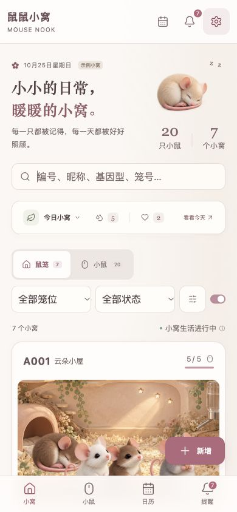
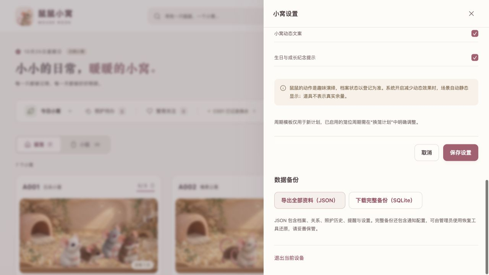

# QA 报告复核与修复 · 2026-10-25

复核对象：用户提供的《鼠鼠小窝-QA测试报告-2026-10-24.md》。原报告实际列出 6 项中等问题、14 项低等问题及 6 项移动端推断，标题中的汇总数字与正文不一致，以下按正文编号逐项对应。

修复前，本地 HEAD 与 VPS `/srv/mouse-nook/deployment.json` 均为 `580b37500143d29bd97dd475077d4a92ce43ec92`。首次复核只检查线上部署标识、服务、备份定时器与资源限额，业务复现使用隔离数据库；后续用户授权将修复同步并部署至 VPS，发布流程见文末。

## 中等问题

| 原编号 | 复核结果 | 修复与边界 |
| --- | --- | --- |
| 一-1 历史周龄提醒 | 存在 | 以登记日为界，只保留登记当日及以后的里程碑。旧版误生成的登记前提醒会取消；登记后真正逾期的提醒继续保留，已处理记录及提醒唯一 ID 不变。补录窝次使用事件创建时间判断登记日。 |
| 一-2 出生日期下限 | 存在 | 个体新增、编辑、窝次新增和更正统一不早于 2000-01-01。使用固定下限，以兼容历史档案；未来日期仍拒绝。 |
| 一-3 空值和零称重 | 存在 | 实际称重必填，范围为大于 0、至多 1000 克；前端以 0.01 克精度输入。安排称重待办仍不要求提前填写结果。 |
| 一-4 文本静默截断 | 存在，原报告的部分概括不准确 | 原小鼠编号已有 `maxlength=64`，其他多项缺少；原鼠昵称新增限制 40，编辑却允许 120，口径也不一致。现在服务端明确拒绝超限并返回字段名；原生文本控件统一限制并显示计数。笼号和鼠号 64、昵称 40、基因型和品系 120、备注 2000；有幼鼠的窝号 59，为子代编号预留后缀。已经被旧版截掉的内容不能凭空恢复。 |
| 一-5 低龄断奶和未断奶转笼 | 存在 | 小于 18 日龄断奶必须填写特殊处理原因；未断奶个体与登记的哺育母鼠分开转笼也必须填写。前后端共享判断，带母鼠一起转笼可正常通过。覆盖档案补录、窝次补录、档案编辑和窝次生日更正，原因保存到事件并显示。18 天用于操作复核提示，不据此自动认定生理状态。 |
| 一-6 无导出/备份/恢复 | 部分存在 | 原已有 SQLite 备份与停服恢复脚本，VPS 每日备份定时器运行中，因此“数据库出问题数据不可挽回”不成立。设置页原缺少下载入口，现增加完整业务 JSON 导出及可恢复的 SQLite 下载。JSON 不含通知密钥，SQLite 包含通知配置；继续使用现有恢复工具，没有增加网页覆盖导入。 |

## 低等问题与观察项

| 原编号 | 复核结果 | 修复与边界 |
| --- | --- | --- |
| 二-1 从笼位登记不预选 | 存在 | 笼位入口传递当前笼 ID，新增表单正确预选。已归档小鼠编辑继续保留原来的空笼位语义。 |
| 二-2 枚举非法值回退 | 存在 | 新增笼位的用途、新增小鼠的性别与断奶/亲缘状态明确校验；缺省值仍允许。照护类型检查改为自有属性检查，拒绝 `toString` 等继承属性。 |
| 二-3 XSS 字符串入库 | 原页面转义有效，不等于已存在可执行 XSS | 编号拒绝尖括号与控制字符；基因型、备注继续作为普通文本保存并转义，不删改可能有业务意义的符号。JSON 下载为附件，不作为 HTML 渲染。 |
| 二-4 已完成待办重复完成 | 存在 | 在生成事件前验证任务为待处理状态，并核对笼位、照护类型、具体小鼠；不同 `opId` 也不能再次完成。原 `opId` 重放仍保持幂等。 |
| 二-5 待办备注丢失 | 存在于“安排时的备注”传递链 | 完成表单预填原待办备注，事件保存原备注快照和本次完成备注。历史时间线也可从旧待办与事件的关联显示已有备注，不只对新记录生效。 |
| 二-6 亲本下拉过滤 | 父本漏性别过滤、出生顺序/未断奶过滤不足 | 新增个体的父本只列雄性，亲本按早于子代出生、非明确未断奶筛选；已有选择保留以便复核。已归档亲本是产品家系追溯能力，继续保留并明确标注，不能一律排除。 |
| 二-7 出生总数报错文案 | 存在 | 改为“历史出生总数不能少于当前活体幼鼠数”；前端原生校验也使用对应中文提示。 |
| 二-8 超容量每次编辑重填原因 | 部分存在 | 原修改昵称也会要求原因；原将容量恢复到足够容纳成员时，代码本就不需要原因，此子情况未复现。现在只有进一步降低容量且仍超限时重填；改名、改备注、扩大或恢复容量无需重填。新增成员和转入的原有容量保护保留。 |
| 二-9 已归档空笼无法删除 | 存在 | 只有建立、资料编辑及归档事件的误录空笼允许删除；成员、窝次、繁育、换笼、任务及业务事件引用继续阻止删除。已归档但有业务历史时明确说明“历史需保留”，不再提示再次归档。 |
| 二-10 计划改到过去 | 存在 | 本次改期新日期不得早于今天；原应换日与实例 ID 保留。历史实际换笼仍可通过补录流程记录。 |
| 二-11 静态缺失返回 200 HTML | 存在 | 已认证的缺失资源和未知页面返回 404；未认证的非公开资源返回 401。登录页必需的鼠图、图标和清单继续公开，根页面保留密码登录流程。 |
| 二-12 英文原生校验 | 与设备语言相关 | 统一表单的必填、数值范围、精度、格式和长度校验提示为中文；浏览器已实测空称重和零体重。 |
| 二-13 动作说明打开设置 | 存在 | 现在打开独立的“关于鼠鼠动作”面板，说明装饰动作与真实登记事实的区别。 |
| 二-14 修改亲本性别定位错误 | 存在 | 在档案编辑阶段定位到 `sex`，文案同时列出本鼠和受影响子代编号，说明其已确认母亲/父亲/寄养母身份。 |

## 移动端实测

本轮使用 Codex 浏览器的 390×844、320×740 响应式视口及 1280×720 默认桌面视口；没有将 Chromium 视口检查当作 iOS Safari 真机验收。

| 原编号 | 复核与处理 |
| --- | --- |
| 三-1 输入聚焦缩放 | 原多个控件字体低于 16px 的 CSS 风险成立。移动表单、搜索、筛选、日历筛选统一为 16px，浏览器计算样式验证通过；真实 Safari 聚焦缩放仍需设备确认。 |
| 三-2 极小字号 | 原月历事项 7px、角标 6px 等声明存在。事项提高为 12px，日期 15px，今天角标 10px，图例和欢迎文字提高到 12px，品牌副标 10px。窄月历局部横向滚动，保留默认日程视图。 |
| 三-3 昵称与长笼号 | 成员编号/昵称上下排列，昵称使用剩余宽度。64 字符笼号省略显示并保留独立笼数；点入档案可查看完整内容。390px 长文本样本昵称可用宽度约 201px，页面宽度及滚动宽度均为 390px。 |
| 三-4 点击热区 | 顶栏图标、筛选、主要按钮、繁育小按钮、文本操作、月历日期及事项等改为至少 44px 高。实测顶栏按钮 44×44，月历事项高度 44px。 |
| 三-5 第二筛选隐藏 | 繁殖状态下拉直接显示，窄屏筛选可换行；移除“更多筛选”中重复出现的移动版状态项。 |
| 三-6 360px 最小宽度 | 移除 `body` 的 360px 最小宽度，320px 首页与日历均为 `scrollWidth=320`。月历网格可在自己的容器内滚动，未造成整页横向溢出。 |

## 验证结果

- 原测试基线 31 项通过；新增 15 项业务回归，最终 `npm test` 为 **46/46 通过**。
- `npm run build` 通过：Service Worker 语法、TypeScript 前后端检查及 Vite 生产构建。
- HTTP 集成测试覆盖认证、Origin、原子保存、冲突、重放、重启持久化；增加导出/备份未认证 401、缺失静态与页面 404、JSON 与当前状态一致且不包含密码、SQLite 文件头与完整性检查，并实际运行恢复脚本检查恢复后的 ID 与 revision。
- 浏览器实测完成笼位预选、低龄原因动态出现、父本过滤、超限昵称报错保留输入、空称重/零体重中文拦截、动作独立说明、长编号布局、移动月历、设置页 JSON 实际下载；最终页未捕获到控制台 error。
- 本机合成数据性能检查：20 笼/100 鼠，状态快照中位数 2.17ms、P95 3.18ms；200 笼/1000 鼠，中位数 26.82ms、P95 34.47ms，JSON 约 1507KB。此为本机 API 层测试，不代表 VPS 延迟、手机帧率或多年事件规模。
- 浏览器视口覆盖已恢复。所有写入均在独立测试库或内存库中；原生产 QA 归档及事件历史未清除。

## 发布与回退

用户已授权将修复同步至 Git 与 VPS。发布脚本使用已提交的 Git HEAD 生成独立版本，在 VPS 构建并运行测试后切换 `current`。实际生效提交、发布时间和上一版本以 `/srv/mouse-nook/deployment.json` 及发布后的验收结果为准。

本轮不改数据库架构版本。正式发布前应保留最新 SQLite 完整备份，再按 `OPERATIONS.md` 的 Git 提交与发布流程执行；激活后核对健康、认证、静态 404、导出及提醒状态。代码可以通过现有 `previous` 发布目录回退；已经产生的取消提醒、特殊处理原因及其他业务事件属于数据变化，不随代码回退恢复，需结合发布前备份复核。

真实 iPhone Safari 聚焦体验、锁屏通知到达与多年事件累积的压力测试未在本轮完成。网页 JSON 导入不属于本次新增能力；完整数据恢复已由原有 SQLite 工具承接。
